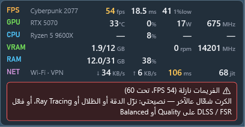
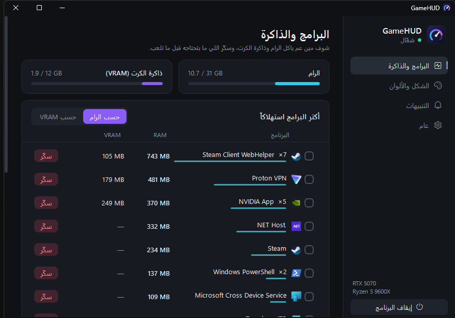
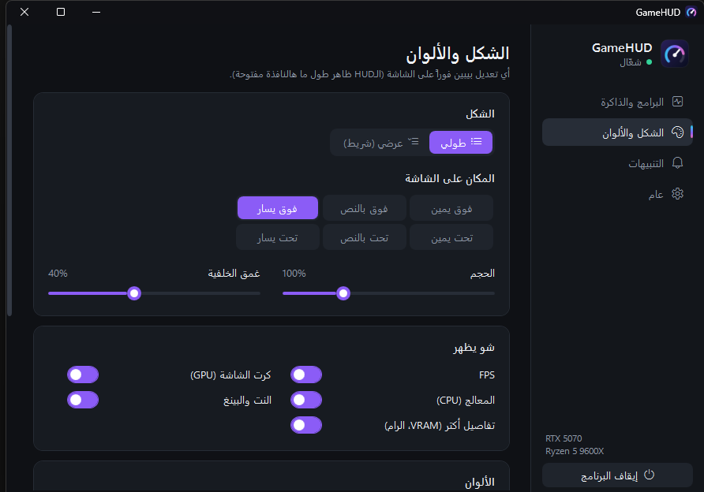

# GHOST — GameHUD

<p align="center"></p>

<p align="center">
<b>شاشة معلومات فوق اللعبة لويندوز 10/11</b> — حرارة وحمل الكرت والمعالج، FPS، البنغ، وتشخيص ذكي لسبب اللاغ وهبوط الفريمات.<br>
<b>An in-game overlay for Windows 10/11</b> — GPU/CPU temps &amp; load, FPS, ping, and plain-language diagnosis of lag and FPS drops.
</p>

<p align="center">
<a href="../../releases/latest"><b>⬇️ تحميل / Download GameHUD.exe</b></a><br><br>
<a href="../../releases"></a>
</p>

| | |
|---|---|
|  |  |
|  |  |

---

## العربية

### شو بيعمل؟
- **فوق اللعبة:** حرارة الكرت والمعالج، نسبة الحمل %، الواط، سرعة الكلوك، **FPS** مع زمن الفريم و**1% low**، سرعة النت رفع/تنزيل، **البنغ**، التذبذب (jitter) وضياع الحزم.
- **ليش البنغ عالي؟** بيقلك بالاسم أي برنامج عم ياكل النت (تحديث، تورنت، ستريم…)، أو إذا السبب الـ VPN، أو الراوتر/الواي فاي، أو مزوّد الخدمة (ISP).
- **ليش الفريمات نازلة؟** بيفرّق بين: الكرت واصل حدّه (GPU-bound)، المعالج واصل حدّه (CPU-bound)، ذاكرة الكرت VRAM أو الرام مليانة، أو حرارة عالية وعم يصير throttling — وبيعطيك نصيحة شو تعمل.
- **مدير الرام والـ VRAM:** بيوريك مين آكل الذاكرة وبتقدر تسكّر البرامج من نفس الشاشة.
- **الشكل:** طولي أو عرضي، ألوان قابلة للتعديل وثيمات جاهزة (نيون، أحمر غيمنغ، ماتريكس، ذهبي…).
- بيكتشف اللعبة لحاله وبيطلع وقت تلعب بس (أو دايماً، أو مطفي).

### اختصارات الكيبورد
| الاختصار | شو بيعمل |
|---|---|
| `Ctrl+Shift+O` | تلقائي ← دايماً ظاهر ← مطفي |
| `Ctrl+Shift+D` | تفاصيل أكتر / أقل |
| `Ctrl+Shift+L` | طولي / عرضي |
| `Ctrl+Shift+G` | اعتبر البرنامج الحالي لعبة (أو شيله) |
| `Ctrl+Shift+H` | فتح لوحة التحكم |

### المتطلبات
- ويندوز 10 أو 11 (64-bit).
- صلاحيات المسؤول (رح يطلب UAC) — لازمة لقراءة الحساسات وحساب الـ FPS عبر ETW.
- لحرارة المعالج: تعريف **PawnIO** من <https://pawnio.eu>.
- **ملاحظة:** هي نافذة شفافة فوق اللعبة، مش حقن داخل اللعبة — يعني بتشتغل بوضع **Borderless / Windowed Fullscreen**، مش بالـ Exclusive Fullscreen.

### التشغيل
نزّل `GameHUD.exe` من صفحة [Releases](../../releases/latest) وشغّله — ملف واحد، ما بدو تنصيب ولا .NET.

---

## English

### What it does
- **In-game overlay:** GPU/CPU temperature, load %, power (W), clocks, **FPS** with frame time and **1% low**, network up/down, **ping**, jitter and packet loss.
- **High-ping diagnosis:** names the app that's eating your bandwidth (updates, torrents, streams…), or points at your VPN, router/Wi-Fi, or ISP.
- **Low-FPS advice:** tells GPU-bound vs CPU-bound vs VRAM/RAM full vs thermal throttling apart, and suggests what to do.
- **RAM/VRAM app manager:** see which apps use memory and close them right from the panel.
- **Looks:** vertical or horizontal layout, custom colors and presets.
- Auto-detects games and shows only while you play (or always, or off).

### Hotkeys
| Hotkey | Action |
|---|---|
| `Ctrl+Shift+O` | Auto → Always → Off |
| `Ctrl+Shift+D` | More / fewer details |
| `Ctrl+Shift+L` | Vertical / horizontal |
| `Ctrl+Shift+G` | Mark / unmark current app as a game |
| `Ctrl+Shift+H` | Open control panel |

### Requirements
- Windows 10/11 x64.
- Administrator rights (UAC prompt) — needed for hardware sensors and ETW-based FPS.
- CPU temperatures need the **PawnIO** driver: <https://pawnio.eu>.
- **Note:** GameHUD is a transparent overlay window, not an injected hook, so it works in **borderless / windowed fullscreen**, not exclusive fullscreen.

### Install
Grab `GameHUD.exe` from [Releases](../../releases/latest) and run it — single self-contained file, no installer or .NET needed.

### Build from source
Requires the [.NET 8 SDK](https://dotnet.microsoft.com/download/dotnet/8.0).

```bash
dotnet publish -c Release -r win-x64 --self-contained true -p:PublishSingleFile=true -p:IncludeNativeLibrariesForSelfExtract=true -p:EnableCompressionInSingleFile=true -p:DebugType=none -o publish
```

The exe lands in `publish/GameHUD.exe`.

For UI work without UAC (no CPU temps / FPS), build with `-p:NoAdmin=true`; `GameHUD.exe --shots <dir>` saves screenshots of the HUD and panels.

---

## Credits
- [LibreHardwareMonitor](https://github.com/LibreHardwareMonitor/LibreHardwareMonitor) (LibreHardwareMonitorLib) — MPL-2.0
- [Microsoft.Diagnostics.Tracing.TraceEvent](https://github.com/microsoft/perfview) — MIT
- [PawnIO](https://pawnio.eu) — CPU sensor driver (installed separately)

## License
[MIT](LICENSE)
